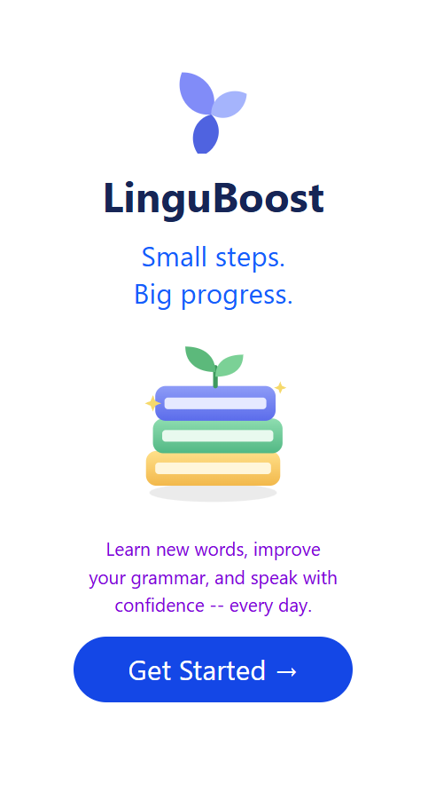

# LinguBoost

### A mobile-first, fully offline language learning app. Vocabulary, flashcards, and conversation practice, built differently from the apps you already know.

# ✨Features

### Vocabulary learning: Build your word bank at your own pace, with a learning flow that goes beyond the usual list-and-quiz format.

### Flashcards: Review words with flashcards designed for quick, focused sessions.

### Conversation practice: Rehearse real-life dialogues so the words you learn actually turn into things you can say.

### Mobile only: Built purely for phones. There is intentionally no desktop version, so every screen, gesture, and interaction is designed for touch.

### Saved name retrieval: Reads the user's saved name from localStorage.

### Personalized display: Shows the saved name in place of the user's default username.

### Goal bar: The bar's width updates dynamically as the numbers change, and the numbers themselves update over time.

### Displaying the date the user joined the app.

### Changing the name with a panel.

# 🛠️ Built With

### HTML

### Tailwind CSS

### JavaScript

# 🖼️ Screenshot

### 

# 📄 LICENSE

### MIT
